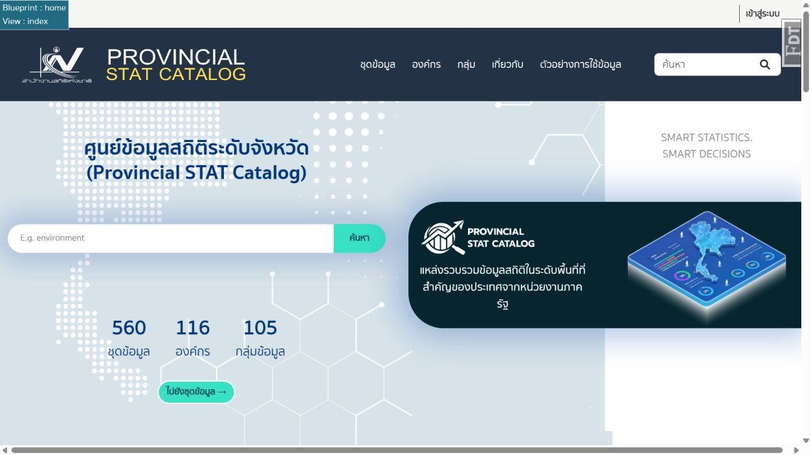

# ckanext-statprovince

ส่วนปรับแต่ง **Provincial STAT Catalog** สำหรับ CKAN-OpenD (CKAN 2.10 + thai_gdc) รวมหน้าแรก Header Footer และกราฟไว้ใน extension เพื่ออัปเดต CKAN หรือ thai_gdc ได้โดยไม่ต้องแก้ไฟล์ต้นฉบับซ้ำ

## ภาพตัวอย่างหน้าแรก



ภาพจากเว็บทดสอบขณะเปิดโหมดพัฒนา

## ความสามารถ

- หน้าแรกแสดงกลุ่ม องค์กร ชุดข้อมูลล่าสุด และชุดข้อมูลยอดนิยม
- Header รองรับจอแคบ และแสดงสีพื้นเฉพาะเมนูที่เลือก
- Footer พร้อมโลโก้ ข้อมูลติดต่อ นโยบาย ตัวเลือกภาษา และจำนวนผู้เข้าชม
- หน้ากลุ่มแสดงกลุ่มแม่–กลุ่มย่อยแบบลำดับชั้น
- ซ่อนป้ายกลุ่มและแท็กชื่อจังหวัดเฉพาะการแสดงผล โดยไม่ลบ metadata
- กราฟ Tags–องค์กร เลือกได้ 5 แบบ: Focus, Cluster, Bipartite, Chord และ Heatmap
- กราฟเริ่มต้นที่ Focus แบบ force-directed และ Top Tags 80 ลากโหนดแล้วเครือข่ายขยับตามกันได้
- กราฟนับเฉพาะชุดข้อมูลสาธารณะ ใช้ Top Tags สูงสุด 100 รายการ และเก็บ cache ใน Redis

## ก่อนติดตั้ง

เครื่องปลายทางต้องมี CKAN ที่ใช้งานได้อยู่แล้ว คู่มือนี้ติดตั้งเฉพาะ extension

| ส่วนประกอบ | การใช้งาน |
|---|---|
| CKAN 2.10 | รุ่นที่ใช้พัฒนาและทดสอบ |
| ckanext-thai_gdc | ต้องติดตั้งและเปิดใช้ เพราะ template และ footer ใช้ helper ของ thai_gdc |
| ckanext-hierarchy | ต้องเปิดใช้สำหรับหน้ากลุ่มแบบลำดับชั้น |
| Redis | ใช้เก็บ cache กราฟ ถ้าเชื่อมต่อไม่ได้จะคำนวณกราฟใหม่แทน |
| Python | ใช้ Python environment เดียวกับ CKAN; package กำหนด Python >= 3.8 |

hierarchy ในเครื่องที่ใช้ทดสอบมี plugin ชื่อ `hierarchy_display`, `hierarchy_form` และ `hierarchy_group_form` โดย `hierarchy_group_form` ใช้จัดการความสัมพันธ์กลุ่มแม่–ลูก

ติดตั้ง dependencies และตั้งค่า plugin ของ thai_gdc/hierarchy ตามคู่มือของแต่ละ extension ก่อน แล้วเลือกวิธีติดตั้ง statprovince เพียงวิธีเดียว

| วิธี | เหมาะกับ |
|---|---|
| [Source](#1-ติดตั้งแบบ-source) | นักพัฒนา หรือเครื่องที่ต้องแก้ template/CSS/Python |
| [Package](#2-ติดตั้งแบบ-package-wheel) | เครื่องที่ต้องการติดตั้งไฟล์ wheel โดยไม่ผูกกับ Git checkout |
| [Docker](#3-ติดตั้งแบบ-docker) | CKAN ที่รันผ่าน Docker Compose |

ตัวอย่าง Git URL ด้านล่างใช้ `YOUR_ACCOUNT` แทนบัญชี GitHub ให้เปลี่ยนเป็น repository ที่เผยแพร่จริงก่อนรัน หากยังไม่เผยแพร่ สามารถคัดลอกโฟลเดอร์ extension ไปใช้แทนการ clone ได้

## 1. ติดตั้งแบบ Source

ตัวอย่างนี้ใช้ Linux และ virtualenv ของ CKAN ที่ `/usr/lib/ckan/default` ถ้าเครื่องใช้ path อื่น ให้เปลี่ยนตามจริง

### 1.1 ดาวน์โหลดและติดตั้ง

ใช้บัญชีที่มีสิทธิ์เขียนโฟลเดอร์ source และติดตั้ง package ใน virtualenv ของ CKAN

```bash
source /usr/lib/ckan/default/bin/activate
cd /usr/lib/ckan/default/src

git clone https://github.com/YOUR_ACCOUNT/ckanext-statprovince.git
cd ckanext-statprovince
python -m pip install -e .
```

`-e` เป็นการติดตั้งแบบ editable ทำให้ CKAN ใช้โค้ดจากโฟลเดอร์นี้โดยตรง

หากคัดลอกโฟลเดอร์มาเอง ให้เข้าโฟลเดอร์ที่มี `setup.py` แล้วรัน `python -m pip install -e .` ได้เช่นกัน

### 1.2 เปิด plugin

แก้ไฟล์ config ที่ CKAN ใช้งานจริง เช่น `/etc/ckan/default/ckan.ini` ตามหัวข้อ [เปิด plugin และตั้งค่า](#4-เปิด-plugin-และตั้งค่า)

### 1.3 Restart CKAN

ถ้าใช้ Supervisor ตามรูปแบบ CKAN-OpenD เดิม:

```bash
sudo supervisorctl restart ckan-uwsgi:*
```

ถ้าเครื่องใช้ systemd หรือ process manager อื่น ให้ restart service ของ CKAN ที่ตั้งไว้ในเครื่องนั้น

### 1.4 อัปเดตภายหลัง

```bash
source /usr/lib/ckan/default/bin/activate
cd /usr/lib/ckan/default/src/ckanext-statprovince
git pull --ff-only
python -m pip install -e .
sudo supervisorctl restart ckan-uwsgi:*
```

ก่อนอัปเดต ควร commit หรือสำรองส่วนที่แก้เองไว้ หากต้องการล็อกรุ่น ให้ checkout tag หรือ commit ที่ตรวจสอบแล้วก่อนติดตั้ง

## 2. ติดตั้งแบบ Package (wheel)

วิธีนี้แยกเครื่องสร้าง package ออกจากเครื่อง CKAN ได้ และไม่ต้องเก็บ Git checkout ไว้บนเซิร์ฟเวอร์ปลายทาง

### 2.1 สร้างไฟล์ wheel

บนเครื่องที่มี Python และ pip ให้เข้าโฟลเดอร์ extension ที่มี `setup.py`

```bash
cd ckanext-statprovince
python -m pip wheel --no-deps --wheel-dir dist .
```

เวอร์ชันปัจจุบันใน `setup.py` คือ `0.1.0` จึงได้ไฟล์ชื่อประมาณ:

```text
dist/ckanext_statprovince-0.1.0-py3-none-any.whl
```

ชื่อไฟล์อาจต่างเล็กน้อยตามเครื่องมือ build ให้ใช้ชื่อไฟล์ที่สร้างได้จริง เมื่อออกรุ่นใหม่ต้องเปลี่ยนเวอร์ชันใน `setup.py` และสร้าง wheel ใหม่

### 2.2 ติดตั้งบนเครื่อง CKAN

คัดลอก wheel ไปเซิร์ฟเวอร์ เช่น `/tmp/` แล้วติดตั้งใน virtualenv ของ CKAN

```bash
source /usr/lib/ckan/default/bin/activate
python -m pip install /tmp/ckanext_statprovince-0.1.0-py3-none-any.whl
```

หากเครื่องปลายทางออกอินเทอร์เน็ตไม่ได้ แต่ติดตั้ง dependencies ครบแล้ว:

```bash
python -m pip install --no-index --no-deps /tmp/ckanext_statprovince-0.1.0-py3-none-any.whl
```

จากนั้นเปิด plugin และ restart CKAN เหมือนวิธี Source

### 2.3 อัปเดต package

ติดตั้ง wheel รุ่นใหม่ แล้ว restart CKAN

```bash
python -m pip install --upgrade /tmp/ckanext_statprovince-NEW_VERSION-py3-none-any.whl
```

เปลี่ยน `NEW_VERSION` เป็นรุ่นจริง หากเคยติดตั้งแบบ editable และต้องการเปลี่ยนมาใช้ wheel ให้ถอนการติดตั้งเดิมก่อน:

```bash
python -m pip uninstall ckanext-statprovince
python -m pip install /tmp/ckanext_statprovince-0.1.0-py3-none-any.whl
```

ไม่ควรแก้ไฟล์ใน `site-packages` โดยตรง ให้แก้ที่ source แล้วสร้าง package รุ่นใหม่

## 3. ติดตั้งแบบ Docker

วิธีที่ใช้ซ้ำได้คือสร้าง image ที่มี extension ติดตั้งอยู่แล้ว การ `pip install` ใน container ที่กำลังรันเหมาะกับการลองชั่วคราว เพราะการเปลี่ยนแปลงอาจหายเมื่อ recreate container

ตัวอย่างนี้ใช้ base image CKAN-OpenD `thepaeth/ckan-thai_gdc:v3.1.0` หากใช้ image อื่น ต้องตรวจให้มี thai_gdc/hierarchy และปรับ path, Python environment และชื่อผู้ใช้ตาม image นั้น

### 3.1 สร้าง image จากโฟลเดอร์ extension

คัดลอกหรือ clone repository ลงเครื่อง จากนั้นสร้างไฟล์ `Dockerfile` ไว้ข้าง `setup.py` ด้วยเนื้อหานี้:

```dockerfile
FROM thepaeth/ckan-thai_gdc:v3.1.0

USER root
COPY . /srv/app/src/ckanext-statprovince
RUN pip install --no-cache-dir /srv/app/src/ckanext-statprovince
USER ckan
```

เพิ่ม `.dockerignore` ในโฟลเดอร์เดียวกัน เพื่อไม่ส่งไฟล์ที่ไม่จำเป็นเข้า build context:

```text
.git
.env
.venv
__pycache__
*.pyc
*.egg-info
build
dist
*.local.*
```

รัน build จากโฟลเดอร์ extension:

```bash
docker build -t ckan-thai_gdc-statprovince:0.1.0 .
```

image นี้ติดตั้งแบบ package และไม่ได้เปิด debug toolbar

### 3.2 ให้ Compose ใช้ image ใหม่

ในโฟลเดอร์ Docker Compose ของ CKAN ให้เปลี่ยน `image` ของ service `ckan` เป็น image ที่สร้างไว้ โดยคงค่า database, Redis, Solr และ volumes เดิมไว้:

```yaml
services:
  ckan:
    image: ckan-thai_gdc-statprovince:0.1.0
```

นี่เป็นเพียงส่วนที่ต้องแก้ในไฟล์เดิม ไม่ใช่ Compose file ที่ใช้รัน CKAN ครบทั้งระบบ หาก service มี `build:` เดิม ให้ปรับหรือนำออกเพื่อไม่ให้ build image เก่าทับ และตรวจ override file ที่ Compose โหลดร่วมด้วย

ใน `.env` ให้เพิ่ม `statprovince` ในรายการ plugin เดิม โดยวางก่อน `thai_gdc` และเปิด plugin ของ hierarchy ที่ระบบใช้อยู่แล้ว ตัวอย่างลำดับเฉพาะส่วน:

```dotenv
CKAN__PLUGINS=statprovince thai_gdc hierarchy_display hierarchy_form hierarchy_group_form
```

อย่าแทนรายการเดิมทั้งหมดด้วยตัวอย่างนี้ ให้เก็บ plugin อื่นของระบบไว้ หาก image ใช้ตัวแปร config คนละชื่อ ให้ใช้ชื่อตามคู่มือ image

เริ่ม service ด้วย image ใหม่จากโฟลเดอร์ Compose:

```bash
docker compose up -d --no-build ckan
docker compose logs --tail=100 ckan
```

### 3.3 โหมดพัฒนา: mount source

ถ้าต้องการแก้โค้ดบนเครื่องแล้วให้ container อ่านไฟล์นั้น ให้เปลี่ยนคำสั่งติดตั้งใน Dockerfile เป็น editable และกำหนดเจ้าของไฟล์:

```dockerfile
FROM thepaeth/ckan-thai_gdc:v3.1.0

USER root
COPY . /srv/app/src/ckanext-statprovince
RUN pip install --no-cache-dir -e /srv/app/src/ckanext-statprovince \
    && chown -R ckan:ckan-sys /srv/app/src/ckanext-statprovince
USER ckan
```

ตัวอย่างเมื่อโฟลเดอร์ `ckan-docker` และ `ckanext-statprovince` อยู่ข้างกัน ให้สร้างหรือแก้ `docker-compose.override.yml` ในโฟลเดอร์ `ckan-docker`:

```yaml
services:
  ckan:
    image: ckan-thai_gdc-statprovince:dev
    build:
      context: ../ckanext-statprovince
      dockerfile: Dockerfile
    volumes:
      - ../ckanext-statprovince:/srv/app/src/ckanext-statprovince
```

```bash
docker compose up -d --build ckan
```

เมื่อแก้ Python ให้ restart service ส่วน template/CSS อาจต้อง restart หรือ rebuild assets ตามการตั้งค่า cache ของ CKAN อย่าเปิด debug mode บน production

### 3.4 อัปเดต Docker ภายหลัง

อัปเดต source แล้ว build เป็น tag ใหม่ จากนั้นเปลี่ยน image ใน Compose และรัน `docker compose up -d --no-build ckan` อีกครั้ง

ไม่ต้องล้าง database หรือ volumes เพื่อติดตั้งหรืออัปเดตธีม

## 4. เปิด plugin และตั้งค่า

ใน `ckan.ini` ให้เพิ่ม `statprovince` ก่อน `thai_gdc` และเปิด plugin ของ hierarchy ที่ติดตั้งอยู่แล้ว เก็บ plugin อื่นทั้งหมดของระบบไว้

ตัวอย่างนี้แสดงเฉพาะส่วนที่เกี่ยวข้อง ไม่ใช่รายการ plugin ครบของ CKAN-OpenD:

```ini
ckan.plugins = statprovince thai_gdc hierarchy_display hierarchy_form hierarchy_group_form
```

อย่าเปิด `statprovince` พร้อมธีมอื่นที่แทนหน้าแรกชุดเดียวกัน เพราะลำดับ template อาจทำให้หน้าตาไม่ตรงที่ต้องการ

ค่าที่ extension รองรับ:

```ini
ckanext.statprovince.graph.cache_ttl = 3600
ckanext.statprovince.footer.address = ที่อยู่หน่วยงาน
ckanext.statprovince.footer.phone = หมายเลขโทรศัพท์
ckanext.statprovince.footer.email = contact@example.org
```

หากไม่ตั้งข้อมูลติดต่อ จะใช้ข้อมูลสำนักงานสถิติแห่งชาติที่มากับ extension

กราฟโหลด vis-network เวอร์ชัน 9.1.9 จาก unpkg.com เป็นค่าเริ่มต้น หากเซิร์ฟเวอร์ออกอินเทอร์เน็ตไม่ได้ ให้จัดเตรียมไฟล์ JavaScript ของเวอร์ชันนี้ในพื้นที่ static แล้วตั้ง URL เช่น:

```ini
ckanext.statprovince.vis_network_url = /statprovince/vendor/vis-network.min.js
```

ตัวอย่าง path นี้ยังไม่มีไฟล์แถมมา ต้องวางไฟล์เองก่อนใช้งาน หน้าแรกยังอ้างฟอนต์/ไอคอนจากบริการภายนอก จึงควรเตรียม assets เหล่านี้ด้วยหากต้องใช้งานแบบออฟไลน์ทั้งหมด

## 5. เปิดระบบนับยอดเข้าชม

รายการล่าสุดเรียงตาม `metadata_modified` ส่วนยอดนิยมเรียง `views_total` จากทั้งแค็ตตาล็อก การติดตั้ง extension อย่างเดียวไม่ได้เปิด tracking หรือตั้ง cron ให้อัตโนมัติ

ใน `ckan.ini`:

```ini
ckan.tracking_enabled = true
```

สำหรับ CKAN-OpenD Docker ชุดในตัวอย่าง ให้ตั้งใน `.env` แล้ว recreate service:

```dotenv
CKAN__TRACKING_ENABLED=true
```

```bash
docker compose up -d ckan
```

ประมวลผลยอดที่เก็บไว้และอัปเดต search index ของรายการที่เกี่ยวข้อง:

```bash
# ติดตั้งแบบ Source / Package
/usr/lib/ckan/default/bin/ckan -c /etc/ckan/default/ckan.ini tracking update

# Docker: รันจากโฟลเดอร์ Compose
docker compose exec -T ckan ckan -c /srv/app/conf/ckan.ini tracking update
```

ตั้ง cron ด้วยบัญชีที่มีสิทธิ์รัน CKAN เช่น ทุก 5 นาที สำหรับ Source / Package:

```cron
*/5 * * * * /usr/lib/ckan/default/bin/ckan -c /etc/ckan/default/ckan.ini tracking update >> /tmp/ckan-tracking.log 2>&1
```

สำหรับ Docker บน Linux สามารถตั้ง cron บน host โดยเปลี่ยน `/opt/ckan-docker` และ path ของ Docker ให้ตรงกับเครื่อง:

```cron
*/5 * * * * cd /opt/ckan-docker && /usr/bin/docker compose exec -T ckan ckan -c /srv/app/conf/ckan.ini tracking update >> /tmp/ckan-tracking.log 2>&1
```

ตัวอย่าง cron เป็นรูปแบบ `crontab -e` ของผู้ใช้ หากใช้ `/etc/cron.d/` ต้องเพิ่มชื่อผู้ใช้หลังช่องเวลา บน Windows ให้ใช้ Task Scheduler เรียกคำสั่งเดียวกันแทน

ยอดเข้าชมไม่ใช่จำนวนผู้ใช้ที่ออนไลน์ทันที ต้องรอรอบประมวลผล และยอดจากเว็บต้นทางจะไม่ถูกยกมาด้วยเมื่อนำเข้า metadata

## 6. ตรวจสอบหลังติดตั้ง

ตรวจว่าติดตั้ง package ใน environment ที่ถูกต้อง:

```bash
python -m pip show ckanext-statprovince
```

สำหรับ Docker:

```bash
docker compose exec -T ckan pip show ckanext-statprovince
```

เปิดหน้าแรก `/group/`, `/dataset/` และ `/graph` เพื่อตรวจ Header Footer กลุ่ม และกราฟ จากนั้นตรวจ API โดยแทน `YOUR_CKAN_URL` ด้วย URL จริง:

```bash
curl -fsS "https://YOUR_CKAN_URL/api/3/action/status_show"
curl -fsS "https://YOUR_CKAN_URL/api/3/action/statprovince_tag_org_graph"
```

`status_show` ควรมี `statprovince` ในรายการ extensions และ API กราฟต้องมี `success: true` พร้อม `nodes`, `edges`, `generated_at`

คำสั่งดูแล cache กราฟ:

```bash
ckan -c /etc/ckan/default/ckan.ini statprovince graph-refresh
ckan -c /etc/ckan/default/ckan.ini statprovince graph-clear
```

หากใช้ Docker ให้เติม `docker compose exec -T ckan` ข้างหน้า และเปลี่ยน config path เป็น `/srv/app/conf/ckan.ini`

## 7. ย้ายจากเว็บที่เคยแก้ CKAN/thai_gdc โดยตรง

สำรองไฟล์และฐานข้อมูลก่อน แล้วตรวจส่วนที่เคยแก้เทียบกับ extension หลังติดตั้งและทดสอบครบจึงค่อยเลิกใช้งานไฟล์เก่า เช่น:

- `public/home/` และ template หน้าแรกเดิมที่แก้ตรง
- `public/base/html/nw_graph_wlink.html`
- cron/script ที่สร้างกราฟ static เดิม

คืน template ของ thai_gdc ให้ตรงกับรุ่นที่ติดตั้ง และตรวจว่าไม่มี CSS/JS เก่าถูกโหลดซ้ำกับ extension

## ข้อมูลและรูปภาพ

การติดตั้ง extension ไม่ได้นำเข้าชุดข้อมูล องค์กร กลุ่ม หรือยอดเข้าชมให้อัตโนมัติ ข้อมูลเหล่านี้อยู่ในฐานข้อมูล CKAN แยกจาก repository

รูปโลโก้และรูปหมวดข้อมูลมาจาก statprovince.gdcatalog.go.th, gdcatalog.go.th และ nso.go.th เพื่อแสดงหน่วยงานและบริการต้นทาง ไฟล์ใน `public/statprovince/images/catalog/` เป็นรูปที่เก็บไว้สำหรับเว็บทดสอบ ส่วนภาพกลางใช้กับรายการที่ต้นทางไม่มีรูป

หากย้ายฐานข้อมูลไปโดเมนใหม่ ให้ตรวจ URL รูปใน metadata เพราะ URL แบบ absolute ของเครื่องเดิมไม่ได้เปลี่ยนตามการติดตั้ง extension

## แก้ปัญหาเบื้องต้น

| อาการ | จุดที่ควรตรวจ |
|---|---|
| ไม่รู้จัก plugin `statprovince` | pip ติดตั้งใน Python environment เดียวกับ CKAN หรือไม่ |
| หน้าเว็บยังเป็นธีมเดิม | ลำดับ plugin, ธีมอื่นที่แทนหน้าแรก และการ restart/โหลด assets ใหม่ |
| หน้ากลุ่มหรือ footer แจ้ง helper error | ติดตั้งและเปิด thai_gdc/hierarchy ครบหรือไม่ |
| กราฟไม่ขึ้น | API กราฟ, browser console และ URL ของ vis-network |
| ยอดนิยมเป็น 0 | เปิด tracking แล้วหรือไม่ มีผู้เปิดหน้าชุดข้อมูล และรัน `tracking update` แล้วหรือยัง |
| รูปไม่ขึ้นหลังย้ายเครื่อง | URL รูปใน metadata ยังชี้โดเมนเดิมหรือไม่ |

## License

โค้ด extension ใช้ [AGPL-3.0](LICENSE) ส่วนเครื่องหมายและรูปของหน่วยงานมีแหล่งที่มาตามที่ระบุด้านบน
